<div align="center">


<br/>

[](https://www.linkedin.com/in/erichfr/)
[](https://github.com/erichfr)
[](mailto:erichfrr@gmail.com)

</div>

## 👨‍💻 Sobre mim

Desenvolvedor **Full Stack com foco em Backend**, especializado em **PHP e Laravel**. Atuo na evolução de sistemas corporativos, integrações, APIs REST e otimização de bancos de dados, sempre buscando soluções sustentáveis, seguras e performáticas.

- 🏗️ **Arquitetura:** MVC, sistemas ERP/CRM e multi-tenancy
- 🔌 **Backend:** PHP, Laravel, APIs REST e integrações
- 🗄️ **Dados:** MySQL, MariaDB e otimização de consultas
- 🔄 **Colaboração:** Git, pull requests, code review e CI/CD
- 📍 **Localização:** Rio de Janeiro, Brasil

## ⚡ Stack em movimento

<div align="center">
  
</div>

### 🧰 Tecnologias & Ferramentas

**Backend**


**Frontend**


**Dados & Ferramentas**


## 🚀 O que gosto de construir

```text
✅ Aplicações PHP / Laravel com foco em manutenção e escala
✅ Integrações e APIs REST bem estruturadas
✅ Sistemas corporativos ERP e CRM
✅ Soluções multi-tenant e consultas SQL performáticas
✅ Automações e melhoria contínua da experiência do usuário
```

---

<div align="center">

### 🤝 Vamos nos conectar?

**Aberto a conexões, colaboração e troca de conhecimento.**

[](https://www.linkedin.com/in/erichfr/)

</div>
