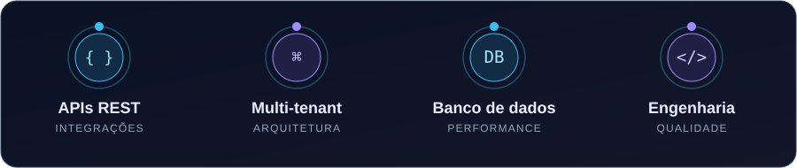

<div align="center">



<br />

**Desenvolvedor Full Stack · Foco em Backend · Rio de Janeiro, Brasil**

[](https://www.linkedin.com/in/erichfr/)
[](mailto:erichfrr@gmail.com)
[](https://github.com/erichfr)

</div>

## `> whoami`

Sou desenvolvedor **PHP/Laravel**, com foco em **Backend** e experiência construindo e evoluindo aplicações corporativas. Gosto de transformar regras de negócio complexas em código claro, APIs consistentes e consultas eficientes.

No dia a dia, trabalho com **ERP/CRM**, arquiteturas **multi-tenant**, integrações entre sistemas, manutenção de aplicações legadas e melhorias de performance e segurança.

## `> areas --focus`

<div align="center">

</div>

## `> stack --list`

| Área | Tecnologias e práticas |
| :-- | :-- |
| **Backend** | PHP · Laravel · CodeIgniter · APIs REST |
| **Dados** | MySQL · MariaDB · PostgreSQL · SQL tuning |
| **Frontend** | JavaScript · Vue.js · HTML · CSS · Bootstrap |
| **Ferramentas** | Git · GitHub · Docker · VS Code · Postman |
| **Engenharia** | MVC · Multi-tenancy · Code Review · CI/CD |

## `> build --what-matters`

```php
<?php

$principios = [
    'arquitetura'   => 'simples de evoluir',
    'apis'          => 'claras e previsíveis',
    'consultas'    => 'eficientes',
    'seguranca'     => 'desde o início',
    'codigo'        => 'legível e testável',
];
```

### 🚀 O que me motiva

Projetar soluções que resolvam problemas reais — especialmente **integrações**, **automações**, **otimização de banco de dados** e evolução sustentável de sistemas em produção.

---

<div align="center">

**Tem uma ideia, desafio técnico ou oportunidade? Vamos conversar.**

[](https://www.linkedin.com/in/erichfr/)

<sub>Construído com atenção aos detalhes — e uma dose saudável de curiosidade. ⚡</sub>

</div>
